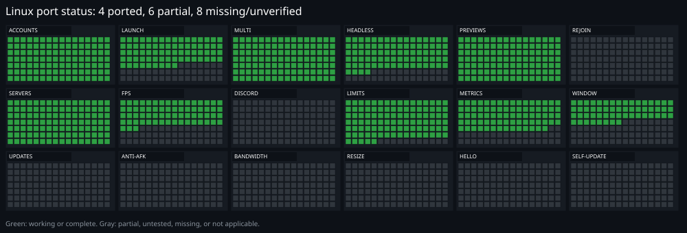

# RoALT for Linux

> [!WARNING]
> **This Linux fork is a work in progress.** Some features are missing or incomplete, some may not work
> as intended, and performance and memory use are still being improved. Expect rough edges, and keep
> backups of your accounts and vault.

## Linux port status



Status is for this Linux fork, not upstream Windows RoALT. Green means working or complete; gray means
partial, untested, missing, or not applicable. The image covers accounts, launching, multi-client, headless
mode, previews, recovery, servers, FPS, Discord, limits, metrics, window controls, updates, anti-AFK,
bandwidth, resizing, Windows Hello, and self-update.

RoALT is a local-only Roblox account manager and multi-client launcher, running as a Tauri desktop app.
This branch is the Linux fork: it launches Roblox through **Cordial** and keeps cookies encrypted on
your machine. It talks only to Roblox and your own Discord webhook if you configure one. Self-update is
disabled on Linux.

No RoALT account, no RoALT server, no telemetry.

## Requirements

> [!NOTE]
> This fork requires Cordial for the supported Linux path.
>
> | Requirement | Notes |
> |---|---|
> | Linux desktop | Wayland or X11. Hyprland gives the best window controls (focus, hide, reveal). |
> | Cordial | Required for the supported Linux path. Gives every account its own profile and allows several clients at once. |
> | Cage | Required only for **Headless clients** (`cage` must be on `PATH`). |
> | WebKitGTK | Used for RoALT's own UI and Roblox sign-in windows. |

RoALT finds `cordial-run` on `PATH` and uses the newest build under Cordial's cache. You can point it at another loader with `ROALT_CORDIAL_RUN=/path/to/cordial-run`.


## Install

There is no Linux installer or prebuilt package in this fork. Build it from source:

```bash
git clone https://github.com/itaplyr/RoALT.git
cd RoALT
npm ci
npm run build
cargo build --release --manifest-path src-tauri/Cargo.toml
./src-tauri/target/release/roalt
```

Development build with hot reload:

```bash
npm run tauri dev
```

### Build dependencies

Arch Linux:

```bash
sudo pacman -S --needed base-devel curl wget file openssl \
  webkit2gtk-4.1 libappindicator-gtk3 librsvg patchelf
```

Debian/Ubuntu:

```bash
sudo apt install build-essential curl wget file libssl-dev \
  libwebkit2gtk-4.1-dev libgtk-3-dev libayatana-appindicator3-dev \
  librsvg2-dev patchelf
```

Also install Node.js 24, a stable Rust toolchain, Cordial, and — for headless clients — `cage`.

## Launching Roblox

RoALT starts `cordial-run` directly with a per-account profile:

```text
cordial-run --profile roalt_<user id> --join-url <roblox link>
```

This is the same direct path Cordial's own shell uses, but RoALT supplies the profile and link itself.
That avoids Cordial's profile picker and keeps each account isolated.

### FPS cap

The **Performance → FPS cap** setting is applied on Linux through Cordial. It can still be ignored by
some Cordial builds or after the client rewrites its settings, so treat it as best effort. The
precedence is:

1. the cap chosen for this launch on the Play page;
2. the account's own cap;
3. the global Performance setting;
4. `0` leaves the client alone.

For Cordial, RoALT writes a merged flags file for the launch and points `CORDIAL_FLAGS` at it. The file
contains the account profile's existing flags plus:

```json
{ "DFIntTaskSchedulerTargetFps": 60 }
```

Because `CORDIAL_FLAGS` takes precedence over the profile's own `flags.json`, a leftover
`DFIntTaskSchedulerTargetFps` in that file can no longer silently defeat RoALT's setting. Other flags in
the profile are preserved.

### Headless clients

With **Headless clients** enabled, RoALT passes `--headless` to Cordial. Cordial re-execs under cage with
`WLR_BACKENDS=headless`, clears `DISPLAY` and `WAYLAND_DISPLAY`, and renders with no window on your
desktop.

A true headless client has no host window to reveal. That means:

- its preview comes from Cordial's dev-control socket (`screenshot`), not from a window capture;
- clicking **Show** closes it and restarts it windowed;
- **Minimize** on a windowed client also switches it to headless, because the window's memory cannot be
  reclaimed in place.

Headless clients also get `CORDIAL_AUDIO=aaudio-refuse`, so FMOD opens no audio stream.

### Window controls

On Hyprland, RoALT uses `hyprctl` for focus, hide, and reveal. It finds a window by the tracked PID and
its child processes, because the window may belong to a Cordial child rather than the process RoALT
started. Other compositors can launch clients, but the focus/minimize/restore controls may not work.

## Data and privacy

RoALT data lives in:

```text
$XDG_DATA_HOME/roalt     (usually ~/.local/share/roalt)
```

It contains the SQLCipher database, logs, and temporary webview data. Logs for Roblox clients are under
`logs/clients/`. Set `ROALT_DATA_DIR` to use a different folder, or move the folder from **Settings → Data**.

On Linux the vault key is derived from `/etc/machine-id` (or the DBus machine id) and your user id. This
is not as strong as Windows DPAPI: a copy of the database and machine id from the same machine can be
opened elsewhere. Set a **master password** if you want the vault protected against that.

RoALT does not implement Windows Hello on Linux. Master-password re-authentication is the available path.

## What works on Linux

| Area | Status |
|---|---|
| Accounts, avatars, presence, Robux, friends, groups, aliases, notes | Works |
| Roblox sign-in through WebKitGTK, cookie import, cookie checks | Works |
| Launch one account or many, same-server batches, favourites | Partial: launching does not always open the game directly |
| Auto-rejoin, auto-restart, crash breaker, rejoin history | Untested |
| Server browser and private servers | Works |
| Home previews, live state, uptime, CPU, private memory, disk I/O | Works through `/proc` and Cordial devctl |
| Per-client CPU niceness, core affinity, efficiency priority | Works through the Linux scheduler |
| Adaptive limits, memory throttle, trim scheduling | Works; trim itself is a no-op on Linux |
| FPS cap and lowest graphics (Cordial) | Partial: FPS is best effort and sometimes ignored; graphics depend on the Cordial build |
| Headless clients under cage | Partial: no host window, but headless handling can still be improved |
| Hyprland focus, minimize, restore, hidden workspaces | Works |
| Discord alerts and rich presence | Untested |
| Encrypted `.roalt` backups, recovery codes, performance profiles | Works |
| Localization and themes | Works |

## Linux limitations

- **Anti-AFK is not available.** Linux input injection is not wired up.
- **Bandwidth limiting is not available.** There is no QoS equivalent in this build.
- **GPU metrics are not available.** CPU, memory and disk I/O are sampled from `/proc`.
- **Free per-window resizing is not implemented.** The compositor owns window geometry.
- **Windows Hello is not available.** Use a master password for re-authentication.
- **RoALT does not self-update.** Update it the way you built or installed it.
- **Roblox client updates are handled by Cordial and have not been tested here.** RoALT does not run
  Roblox's Windows installer.
- **`Take over` and the Windows singleton lock do not apply.** Cordial profiles provide multi-instance.
- **True headless clients cannot be shown without a restart.** They have no host window, and headless
  handling still has room for improvement.
- **Rejoin, Discord, and update flows are not tested yet.** The UI may expose them, but do not rely on
  them until they have been verified.

## Development

Architecture, tests, and useful commands:

```bash
npm run build       # TypeScript check, i18n check, Vite build
npm run typecheck   # TypeScript only
npm run bindings    # regenerate src/bindings from Rust types
cd src-tauri
cargo test --locked
cargo clippy --all-targets --locked -- -D warnings
```

### Project layout

```text
src/                         React UI
src-tauri/src/main.rs        Tauri builder and managed state
src-tauri/src/commands.rs    IPC commands
src-tauri/src/launcher/      targets, URIs, bulk launches, Cordial start
src-tauri/src/instances/     process tracking, logs, limits, metrics, windows
src-tauri/src/vault/         encrypted vault and Linux device key
src-tauri/src/storage/       SQLCipher database and migrations
docs/                        design notes and research
```

Linux-specific files include `client_linux.rs`, `process_linux.rs`, `window_linux.rs`, `metrics_linux.rs`,
`limits_linux.rs`, `multi_linux.rs`, `update_linux.rs`, `webview_linux.rs`, and `splash_linux.rs`.

## Troubleshooting

**RoALT says Roblox needs Cordial**
Install Cordial, make sure `cordial-run` is on `PATH`, and check that Cordial has downloaded a
Roblox build. If you use a custom engine, set `ROALT_CORDIAL_RUN`.

**Headless launch fails.**
Install `cage`. RoALT refuses to fall back to a visible window because that would defeat the setting.

**Show restarts the client instead of revealing it.**
That is expected for a true headless client: it has no host window. Start it without Headless if you want
a window that can be shown and hidden.

**The FPS cap seems to do nothing.**
Check that the account profile is being launched through Cordial. RoALT writes the cap into a
merged `CORDIAL_FLAGS` file; confirm the launch log mentions the flags file and the client starts after it.

**Window controls do nothing.**
They currently require Hyprland (`hyprctl`). Launching and previews still work on other compositors.

## Credits

- [RoALT](https://github.com/inspectsoftware/RoALT) — the original Windows project by
  [inspectsoftware](https://github.com/inspectsoftware). This Linux fork is maintained at
  [itaplyr/RoALT](https://github.com/itaplyr/RoALT).
- [Cordial](https://github.com/luohoa97/cordial) — the Android Roblox runtime for Linux by
  [luohoa97](https://github.com/luohoa97), which RoALT uses to launch and manage Roblox clients.

## Disclaimer

RoALT is an independent project, not affiliated with or endorsed by Roblox Corporation. Use it only with
accounts you own. Roblox does not officially support running several clients at once and may change its
client at any time.
