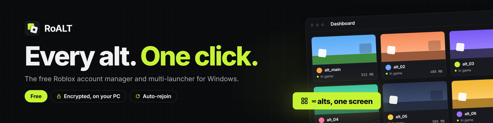
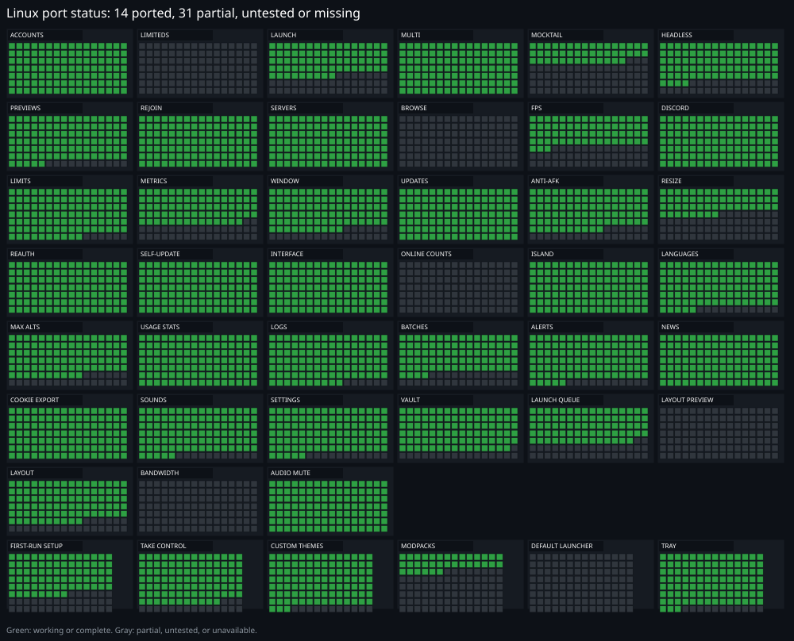
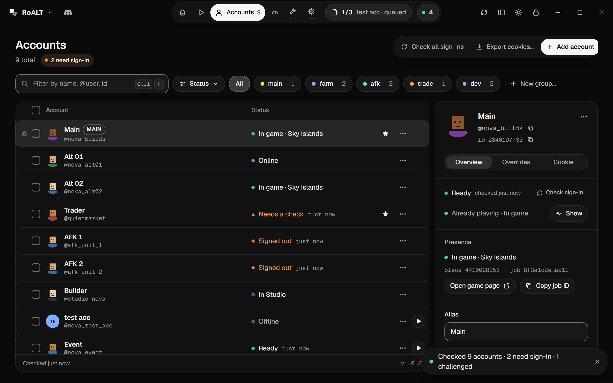
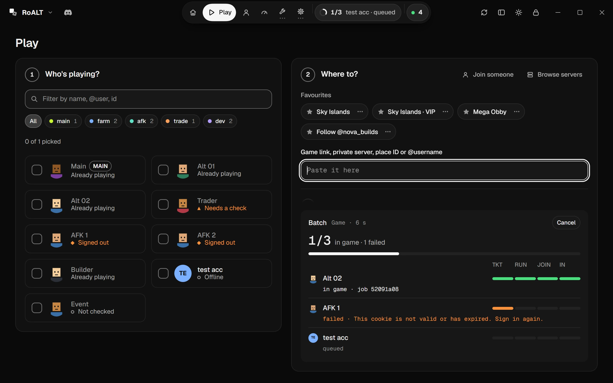
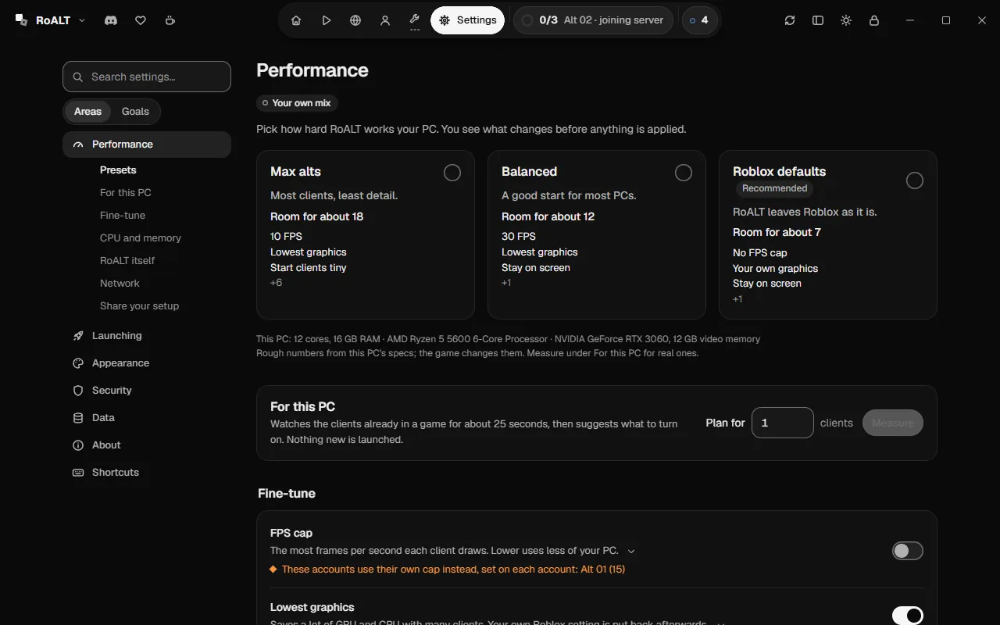
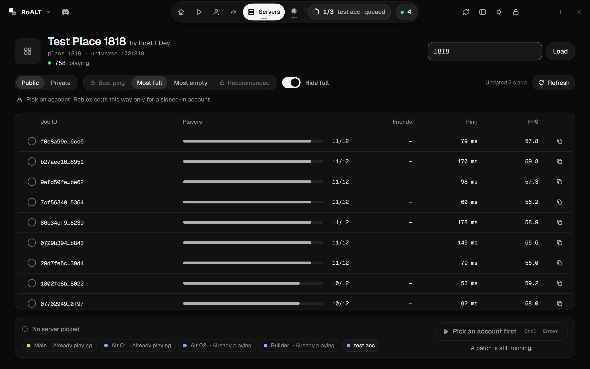
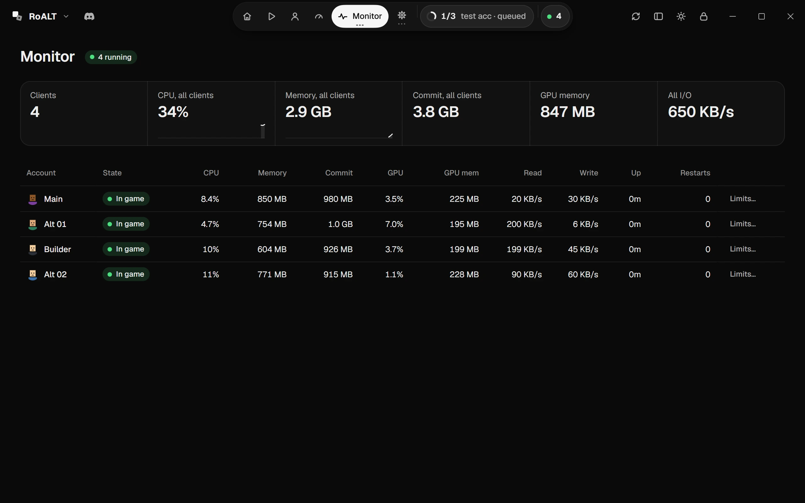
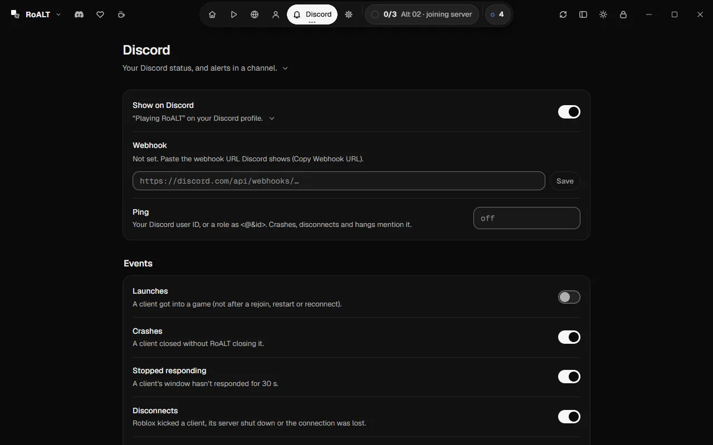
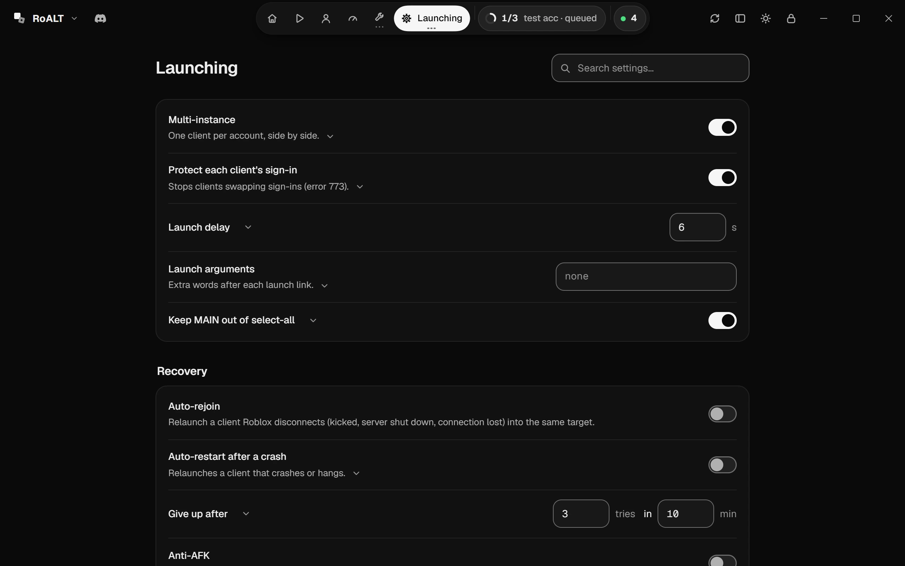
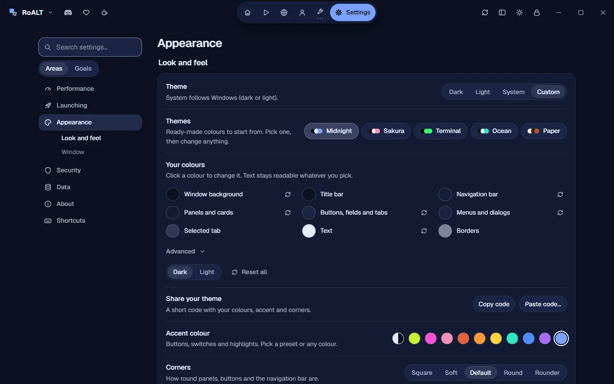

# RoALT for Linux

<h1 align="center">⚠️ IMPORTANT ⚠️</h1>

> [!CAUTION]
> **This fork has changed the way it worked. Now updates will be smaller and more regular instead of big updates every some weeks, i will try to do more frequent ones to fix bugs, if you have problems open an [issue](https://github.com/itaplyr/RoALT/issues).**

> [!WARNING]
> **This Linux fork is a work in progress.** Some features are missing or incomplete, some may not work
> as intended, and performance and memory use are still being improved. Expect rough edges, and keep
> backups of your accounts and vault.





Status is for this Linux fork, not upstream Windows RoALT. Green means working or complete; gray means
partial, untested, missing, or not applicable. The image covers accounts, limiteds, launching,
multi-client, the experimental Mocktail backend, headless mode, previews, recovery, servers, browse, FPS,
Discord, limits, metrics, window controls, updates, anti-AFK, resizing, re-authentication, self-update,
interface, island, languages, Max alts, usage stats, logs, batches, alerts, news, cookie export, sounds,
settings search, vault flow, launch queue, layout preview, online counts, bandwidth, audio mute, first-run
setup, Take control, custom themes, modpacks, diagnostics, the default Roblox launcher and the tray.
Upstream removed macros in v1.0.1, so there is no macros area; it removed Clips, Trades, Outfits, owned
private servers and the Friend requests view in v1.3.0, so those are not port gaps either.

The Mocktail tile is gray on purpose: the backend switch exists, it is experimental, and it has not been verified with a signed-in launch. Multi-instance uses per-account launcher copies and isolated data (experimental); Cordial remains the tested multi-instance
launcher.

[](https://github.com/itaplyr/RoALT/actions/workflows/ci.yml)


RoALT is a local-only Roblox account manager and multi-client launcher, running as a Tauri desktop app.
This branch is the Linux fork: it launches Roblox through **Cordial**, or through the experimental
**Mocktail** backend when that is installed, and keeps cookies encrypted on your machine. It talks only
to Roblox, GitHub for Linux release updates, RoALT's online counter (which you can turn off), Rolimons
(only with **Rolimons values** on) and your own Discord webhook if you configure one.

There is no RoALT account. This fork targets Linux only; for Windows, use
[upstream RoALT](https://github.com/inspectsoftware/RoALT).

## What's new from upstream v1.3.0

The v1.3.0 merge brings upstream v1.2.0–v1.3.0 into this fork: the first-run setup, Take control,
lighter previews, safer sign-in, custom themes, modpacks, diagnostics, the default launcher picker and
tray fixes, on top of the v1.1.0 Browse, details, limiteds and faster-UI work. Shared frontend and
backend features arrive with the merge; anything that depends on a Windows API, or has not been run
on Linux, is called out below. Clips, Trades and Outfits were removed upstream in v1.3.0, so they are
not Linux port gaps.

| Feature | Upstream v1.3.0 | On this Linux fork |
|---|---|---|
| First-run setup | A short setup on a fresh install: language and look, how the vault is unlocked, what you'll use RoALT for, and the first account, then an optional tour. **Settings › About › Setup and tour** replays it. | **Untested.** The React flow (`src/features/onboarding/`) and the saved `onboarded` setting are shared and would open on a fresh profile. The vault step still calls the default mode **Windows sign-in**, while Linux unlocks with the machine-id device key; it needs a Linux wording pass. Not run under WebKitGTK after the merge. |
| Take control | Tick it in a client's menu and RoALT leaves that client alone until it closes: no auto-rejoin, restarts, anti-AFK, limits or window layout. The window is restored, unmuted and brought forward; untick to hand it back. | **Partial.** Shared backend (`instance_take_control` and the client's `held` flag); the window and unmute use the Linux window path and `pactl`. Not exercised on Linux yet. |
| Lighter previews | Home's previews can be **Off** or **1 FPS**, all previews together are capped, and they slow down while RoALT isn't in front. Windows capture no longer waits on the GPU and only redraws when something changes. | **Partial.** Off and the preview frame rate are shared frontend settings; Linux previews are Cordial dev-control screenshots (`window_linux.rs`). The Windows capture/GPU changes do not apply. Not run under WebKitGTK. |
| Safer sign-in | The sign-in window allows only Roblox, Google and Apple pages, uses a browser profile of its own, and deletes the sign-in once the window closes. | **Ported.** The Linux sign-in window already keeps its own profile, restricts navigation to those hosts and deletes auth cookies (`webview_linux.rs`); sign-in itself was exercised. The v1.3.0 hardening has not had a dedicated Linux run. |
| Custom themes | Recolour the window, title bar, navigation, panels, tabs, buttons, menus and text; start from **Midnight**, **Sakura**, **Terminal**, **Ocean** or **Paper**; share a theme as a code. | **Untested.** Shared frontend and CSS tokens; not run under WebKitGTK after the merge. |
| Modpacks | Import a zip of textures, sounds, fonts, cursors, meshes and sky (Bloxstrap's Modifications layout), turn each on or off, order them and export a zip. Roblox's own folder is never changed. | **Partial.** Import, export and the on/off list are shared, but RoALT launches through Cordial, which counts as a bootstrapper, so applying modpacks is skipped (`mods/runtime.rs`); the runtime also copies a Windows Roblox version folder. No modded client on Linux. |
| Diagnostics | Copy or save a redacted report for bug reports: tickets, cookies, the Windows user name and IP addresses are removed. A client that ends badly leaves an autopsy in the log. | **Partial.** Shared redacted report (`diagnostics.rs`) and the Linux client-log autopsy work; there are no Windows crash dumps or event-log details. |
| Default Roblox launcher | Pick what opens `roblox://` and `roblox-player:` links: Roblox, a bootstrapper or RoALT, and RoALT launches through it. | **Missing.** Upstream writes the choice into the Windows registry; the fork has no Linux `roblox://` handler switch yet. |
| Tray fixes | Tray menu with favourites, window tools, Play all again and Anti-AFK; v1.2.3 fixed RoALT getting stuck in the tray and becoming unresponsive. | **Partial.** Shared Tauri tray and Rust commands; the fix is shared, but not re-tested on Linux. |
| Clips, Trades, Outfits | **Removed upstream in v1.3.0**, together with owning or buying private servers and the Friend requests view. Joining private servers by link, the Servers › Private tab, Limiteds and Browse's purchase lock stay. | **Not applicable.** The fork follows the removal; none of these has a Linux port. |
| Mocktail backend | Not upstream, which drives Windows Roblox directly. | **Experimental.** This fork uses `mocktail` when it finds one: normally one client; Multi-instance uses per-account launcher copies and isolated data, and there are no live previews. A per-account cookie is taken from the vault. Not yet verified with a signed-in launch. |
| Macros | **Removed upstream in v1.0.1**: the page, client-menu actions, settings, backup entries, hotkeys and the macros table are gone. | **Not applicable.** The fork follows the removal; there is no macro runner to port. |

## Requirements

> [!NOTE]
> This fork launches Roblox through Cordial. The optional Mocktail backend is experimental:
> upstream Mocktail is single-instance. RoALT’s Multi-instance setting uses per-account launcher
> copies and isolated Android data; that path is untested with a signed-in launch and is not a
> replacement for the tested Cordial multi-instance path.
>
> | Requirement | Notes |
> |---|---|
> | Linux desktop | Wayland or X11. Hyprland gives the best window controls (focus, hide, reveal). |
> | Cordial | The supported launcher. Gives every account its own profile and allows several clients at once. |
> | Mocktail (optional) | Experimental alternative, used automatically when present. One client by default; Multi-instance uses per-account launcher copies and isolated data. No live previews. |
> | Cage | Required only for **Headless clients** (`cage` must be on `PATH`). |
> | WebKitGTK | Used for RoALT's own UI, Roblox sign-in windows and Browse. |

RoALT looks for a launcher in this order: `mocktail` on `PATH`, then `~/.local/bin/mocktail`, then `/usr/bin/mocktail`, then
`cordial-run` on `PATH` and the newest build under Cordial's cache. Set
`ROALT_LAUNCHER=/usr/bin/cordial-run` to force Cordial when both are installed, or point
`ROALT_CORDIAL_RUN` at a self-built `cordial-run`. `ROALT_LAUNCHER` accepts any other loader path too,
but only Cordial and Mocktail are documented here.

## Install

Download the installer, review it, then run it:

```bash
curl -fsSLO https://github.com/itaplyr/RoALT/releases/latest/download/install-linux.sh
less install-linux.sh
bash install-linux.sh
```

It supports Arch, Debian/Ubuntu, Fedora, openSUSE, Alpine, Void, and unknown
distributions with a supported package manager. It installs Cage and Cordial
when missing, verifies the RoALT binary's SHA-256, puts RoALT in `~/.local/bin`,
and adds a desktop entry. It does not install Mocktail; install that yourself if
you want to try the experimental backend. To upgrade later, run the same command
again or use the in-app update banner. The script needs `bash`, `curl`, and
`sha256sum` (Alpine: `sudo apk add bash` first).

RoALT updates itself only its own binary: it checks this fork's GitHub releases at startup and every
five minutes, verifies the SHA-256 and restarts. Cordial, Mocktail, Cage and the desktop entry come from
the installer script or your package manager, not the updater.

Build from source instead:

```bash
git clone https://github.com/itaplyr/RoALT.git
cd RoALT
npm ci
npm run build
cargo build --release --manifest-path src-tauri/Cargo.toml
./src-tauri/target/release/roalt
```

Development build with hot reload:

```bash
npm run tauri dev
```

### Build dependencies

Arch Linux:

```bash
sudo pacman -S --needed base-devel curl wget file openssl \
  webkit2gtk-4.1 libappindicator-gtk3 librsvg patchelf
```

Debian/Ubuntu:

```bash
sudo apt install build-essential curl wget file libssl-dev \
  libwebkit2gtk-4.1-dev libgtk-3-dev libayatana-appindicator3-dev \
  librsvg2-dev patchelf
```

Also install Node.js 24, a stable Rust toolchain, Cordial (or, experimentally, Mocktail), and — for
headless clients — `cage`.

## 🏁 Quick start

The first time RoALT starts, a short setup walks you through it: language and look, how your accounts are kept safe, what you'll use RoALT for, and your first account, then an optional tour. Skipped it? Settings › About › **Start again**.

<details open>
<summary><b>1. Add your first account</b></summary>
<br>

Press **Add account** (or `Ctrl+N`). A clean Roblox sign-in window opens: sign in as usual, including 2-step
or passkeys. RoALT keeps the sign-in, closes the window and throws its browser profile away. You can also
paste a `.ROBLOSECURITY` cookie; it is checked before it is saved.

</details>

<details>
<summary><b>2. (Optional) Set a master password</b></summary>
<br>

By default the vault is unlocked by this machine's id and your user. For extra protection, set a master
password in **Settings**. RoALT then asks for it on start and locks itself after you've been idle.

</details>

<details>
<summary><b>3. Launch a game</b></summary>
<br>

Go to **Play** (`Ctrl+3`), pick an account, paste a game link and press the big **Play** key
(`Ctrl+Enter`). Pick several accounts to launch a batch. Under **More options**, turn on **Same server**
to put them all in one server.

</details>

<details>
<summary><b>4. Run several clients at once</b></summary>
<br>

Multi-instance comes from Cordial: every account gets its own Cordial profile, so clients do not share a
sign-in or a data folder. The experimental Mocktail backend does this differently: when Multi-instance
is on, RoALT copies the launcher per account and gives each account isolated auth, cache, state and
Android data roots. That path is not yet verified with a signed-in launch. Start clients from RoALT so
it can track them; a client started outside RoALT is not followed. Every client RoALT starts shows up
on **Home** (`Ctrl+1`), with its state, game and uptime.

</details>

<details>
<summary><b>5. Let it look after your clients</b></summary>
<br>

In **Settings → Launching**, turn on **Auto-rejoin** (and, if you like, **Auto-restart**). Open **Monitor**
(`Ctrl+6`) to see what each client uses, and **Discord** (`Ctrl+7`) to get alerts on your phone.

</details>

<details>
<summary><b>⌨️ Keyboard shortcuts</b></summary>
<br>

| Keys | Action |
|---|---|
| `Ctrl+1` … `Ctrl+9` | Home, Accounts, Play, Servers, Settings, Monitor, Discord, Debug, Settings › Performance |
| `Ctrl+N` | Add account |
| `Ctrl+F` | Search accounts |
| `Ctrl+Enter` | Play |
| `F5` | Refresh |

</details>

## Screenshots

<table>
<tr>
<td width="50%"><br><sub><b>Accounts:</b> status, groups and details at a glance</sub></td>
<td width="50%"><br><sub><b>Play:</b> who plays, where, and each account's progress</sub></td>
</tr>
<tr>
<td><br><sub><b>Performance:</b> presets, For this PC and fine-tuning</sub></td>
<td><br><sub><b>Servers:</b> pick a server, send any accounts into it</sub></td>
</tr>
<tr>
<td><br><sub><b>Monitor:</b> what every client uses, every 2 seconds</sub></td>
<td><br><sub><b>Discord:</b> your status, and alerts in your own channel</sub></td>
</tr>
<tr>
<td><br><sub><b>Settings:</b> one page, Areas or Goals, and a search for any setting</sub></td>
<td><br><sub><b>Custom themes:</b> Midnight, or any colours you like</sub></td>
</tr>
</table>

## Launching Roblox

When Mocktail is installed, RoALT uses it first; otherwise it starts `cordial-run` directly with a
per-account profile:

```text
cordial-run --profile roalt_<user id> --join-url <roblox link>
```

This is the same direct path Cordial's own shell uses, but RoALT supplies the profile and link itself.
That avoids Cordial's profile picker and keeps each account isolated. When a direct loader is not
available, RoALT falls back to Cordial's shell or Flatpak Cordial, which follows a slightly different
path and does not get all of the direct-launch behavior.

### Mocktail backend (experimental)

RoALT prefers `mocktail` on `PATH`, then `~/.local/bin/mocktail`, then `/usr/bin/mocktail`, and only then Cordial. That means a
machine with both installed launches through Mocktail until you override it:

```bash
ROALT_LAUNCHER=/usr/bin/cordial-run roalt
```

`ROALT_LAUNCHER` is also how you point RoALT at a loader in a non-standard place, and it applies to
every launch RoALT makes.

Mocktail's upstream launcher is **single-instance** by policy. With Multi-instance on, RoALT works
around the uid+executable lock by copying the launcher per account and giving each account its own
auth, cache, state and Android data roots; this is experimental and untested with a signed-in launch.
Cordial remains the tested multi-instance launcher.

What differs from the Cordial path:

- **No live preview and no dev-control.** Mocktail exposes no devctl socket, so Home has no preview
  frames and the headless screenshot path has nothing to talk to.
- **Per-account cookie from the vault.** Before a launch RoALT writes the chosen account's cookie out of
  the encrypted vault into the directory named by `MOCKTAIL_AUTH_ROOT`, so the client signs in as that
  account. That copy lives outside the vault: keep the directory private and do not reuse it for another
  account.
- **One account at a time.** Switching accounts means switching the seeded cookie, not running two
  clients.
- **Cordial-specific features do not carry over.** The FPS cap and graphics flags described below go
  through Cordial's flags file, and headless mode is cage through Cordial; no equivalent has been
  verified for Mocktail.

Mocktail support is **experimental**. The switch and the cookie handoff are implemented, but no
signed-in Mocktail launch has been verified on Linux yet. Treat it as a way to try a non-Cordial
launcher, not as a Cordial replacement.

### Launch queue

Play, Home's tabs and cards, Servers, Recently closed and an account's recent servers all share one
launch engine. Launches run one at a time; a running batch blocks single launches too. The same queue
also carries the per-launch FPS cap and the single launch-progress view.

### Batches and same server

Batches launch accounts strictly one after another with a stagger. **Same server** either picks a
public server with room for everyone first, or sends the rest to wherever the first account landed.
Cancel at any time, then re-pick the accounts that did not launch.

### Layout preview

Upstream can draw the planned window spots for a few seconds before launching. The merged Linux
command still uses Windows monitor and window APIs, so **layout preview is not available on Linux yet**.
Fit/Tiny window layouts themselves still use the Linux window-control path where a supported compositor
tool exists.

### Server browser

The Servers page browses public servers by players or ping, lists private servers and sends any chosen
accounts into the selected server. Server selection uses the account's cookie.

### FPS cap

The **Performance → FPS cap** setting is applied on Linux through Cordial. It can still be ignored by
some Cordial builds or after the client rewrites its settings, so treat it as best effort. RoALT also
passes the lighter-rendering and lowest-graphics flags through Cordial; some builds may ignore them.
The FPS precedence is:

1. the cap chosen for this launch on the Play page;
2. the account's own cap;
3. the global Performance setting;
4. `0` leaves the client alone.

For Cordial, RoALT writes a merged flags file for the launch and points `CORDIAL_FLAGS` at it. The file
contains the account profile's existing flags plus the launch's rendering flags, custom FFlags and:

```json
{ "DFIntTaskSchedulerTargetFps": 60 }
```

Because `CORDIAL_FLAGS` takes precedence over the profile's own `flags.json`, a leftover
`DFIntTaskSchedulerTargetFps` in that file can no longer silently defeat RoALT's setting. Other flags in
the profile are preserved.

### Headless clients

With **Headless clients** enabled, RoALT passes `--headless` to Cordial. Cordial re-execs under cage with
`WLR_BACKENDS=headless`, clears `DISPLAY` and `WAYLAND_DISPLAY`, and renders with no window on your
desktop.

A true headless client has no host window to reveal. That means:

- its preview comes from Cordial's dev-control socket (`screenshot`), not from a window capture;
- clicking **Show** closes it and restarts it windowed;
- **Minimize** on a windowed client also switches it to headless, because the window's memory cannot be
  reclaimed in place.

Headless clients also get `CORDIAL_AUDIO=aaudio-refuse`, so FMOD opens no audio stream. Their render
resolution comes from **Performance → Headless resolution** (default `640x360`) and is passed to
Cordial as `CORDIAL_RESOLUTION`; a new value applies the next time a headless client starts.

### Window controls

RoALT finds a window by the tracked PID and its child processes, because the window may belong to a
Cordial child rather than the process RoALT started. It supports Hyprland (`hyprctl`), Sway
(`swaymsg`), and X11 through `xdotool` or `wmctrl`. KDE/GNOME Wayland sessions without one of those
tools can still launch clients and show previews, but window controls may be unavailable.

## Features

The shared RoALT feature set from upstream v1.3.0, described for this Linux fork. Where a behaviour is
Windows-only or unverified on Linux, it says so; the status table further down lists the same areas.

| Area | What you get |
|---|---|
| Encrypted vault | Cookies are encrypted locally. On Linux the vault key derives from the machine id and your user id; set a master password for stronger protection. Encrypted `.roalt` backups and recovery codes work. Windows Hello is not available. |
| Accounts | Add through Roblox's sign-in page (WebKitGTK), by pasting a cookie or many at once, or by importing from Roblox Account Manager. Groups, aliases, notes, colours, favourites, ordering, presence, Robux, friends, followers, subscriptions, join date, email and 2-step status. **Limiteds** are counted on request; untested on Linux. |
| Play | Game links, place IDs, `roblox://` links, job IDs, private server links, `roblox.com/share` links, universes, profiles, `@username`, and joining a friend or another account. Favourites on Play and in the tray. An account that is already playing can be picked too: RoALT asks, then moves its client into the same game or to the emptiest other server (shared flow; not verified on Linux). |
| Browse | roblox.com as any account, plus **Popular**, **Playtime**, game details and player details. Upstream's child webview is Windows-only; Linux opens a kept-profile session window instead, without the in-page details panes. **Untested** under WebKitGTK. |
| Batches | One-at-a-time launches with a stagger, same-server picking or following the first account, cancel and re-pick. |
| Recovery | Auto-rejoin after kicks, shutdowns and lost connections; opt-in auto-restart for crashes, frozen windows and a memory limit; crash breaker and crash history. |
| Island and interface | The title-bar island holds navigation and grows launch progress and running clients. Account tabs, top and side layouts, drag sorting, themes, accent colours, background images and motion preferences. |
| First-run setup | A short setup on a fresh install (language and look, vault, what you'll use RoALT for, first account) and an optional tour, replayable from **Settings › About**. Shared frontend; **untested** under WebKitGTK, and its vault step still says Windows sign-in. |
| Take control | A held client is left alone by RoALT (no auto-rejoin, restart, anti-AFK, limits or layout) until it closes or is handed back; taking it restores, unmutes and focuses the window. Shared backend with the Linux window and `pactl` paths; **not exercised** on Linux. |
| Custom themes | Recolour the window, title bar, navigation, panels, tabs, buttons, menus and text; start from Midnight, Sakura, Terminal, Ocean or Paper; share a theme as a code. Shared frontend; **untested** after the merge. |
| Modpacks | Import, export and order modpacks (textures, sounds, fonts, cursors, meshes, sky). Library management is shared, but applying them is **skipped on Linux**: Cordial counts as a bootstrapper, and the runtime copies a Windows Roblox version folder. |
| Diagnostics | A redacted report for bug reports, and a client autopsy in the log. Linux has the redacted report and client-log autopsy; there are no Windows crash dumps or event-log details. |
| Default Roblox launcher | Pick what opens `roblox://` and `roblox-player:` links (Roblox, a bootstrapper or RoALT). **Missing on Linux**: the upstream setting is Windows-registry only. |
| Tray | Favourites, window tools, Play all again and the Anti-AFK switch, plus a tooltip with the running client count. Shared Tauri tray; the v1.2.3 stuck-in-tray fix is shared but not re-tested on Linux. |
| Home | Live previews for every client, status, game, uptime, CPU and RAM, card sorting and compact cards, plus window and limit actions. Preview capture uses Cordial's dev-control path on Linux; the v1.3.0 Off/1 FPS and preview-cap controls are shared but not yet run here. |
| Limits | Per-client CPU niceness, core affinity, efficiency priority, adaptive background limits and memory throttling. Working-set trim is a no-op on Linux, and there is no job-object hard CPU cap. |
| FPS and graphics | FPS cap, lowest graphics, lighter rendering and graphics flags through Cordial's flags file, plus custom FFlags. Some builds ignore them, so treat them as best effort. |
| Server browser | Public servers by players or ping, private servers, recent servers and same-server launches. |
| Discord | Webhook alerts for crashes, disconnects, restarts and batches, per-account muting, and rich presence through the local Discord app. |
| News | GitHub releases, DevForum announcements and release notes, and Roblox's newsroom in one tab. Ported and loaded under WebKitGTK. |
| Cookie export | Writes a temporary `username:cookie` file and deletes it after ten minutes. Works on Linux through `localtime_r` and atomic file writes. |
| UI sounds | Locally synthesised click and notification sounds, off by default, with a volume control and preview. Shared frontend; untested under WebKitGTK. |
| Settings search | One search finds any setting across Settings, Performance and Discord and jumps to it. Settings render from a shared registry. |
| Online counts | The title bar shows how many people use RoALT now and how many accounts they are playing, beside the Discord button. Every 2 minutes a ping carries a random per-launch ID and the client count, nothing else; turn it off in **Settings › About**. Shared code; untested on Linux. |
| Title-bar refresh | A Refresh (`F5`) key beside the layout key. Shared frontend; untested under WebKitGTK. |
| Donate | **Donate** in the app menu or **Settings › About** opens a Roblox gamepass for the amount you pick. Shared frontend; untested under WebKitGTK. |
| Stop all | End every Roblox process and stop pending launches and rejoins from the app menu, the tray, the running-clients sheet or a panic hotkey. |
| Languages | 18 languages, including Arabic right-to-left. Some newer and Linux-only strings can still fall back to English. |
| Updates | Roblox builds are handled by Cordial. RoALT checks the Linux fork's GitHub releases and updates only its own binary after verifying the SHA-256. |

Upstream's macro runner was removed in v1.0.1 and is not part of this fork. Clips, Trades, Outfits,
owning or buying private servers and the Friend requests view were removed upstream in v1.3.0; the
fork follows the removal and has nothing to port for them. Joining private servers by link, the
Servers › Private tab, Limiteds and Browse's purchase lock remain upstream; on Linux the separate
Browse session window does not enforce that lock (see **What works on Linux**).

## Data and privacy

RoALT data lives in:

```text
$XDG_DATA_HOME/roalt     (usually ~/.local/share/roalt)
```

It contains the SQLCipher database, logs, temporary exports and temporary webview data. Logs for Roblox
clients are under `logs/clients/`. Set `ROALT_DATA_DIR` to use a different folder, or move the folder
from **Settings → Data**.

On Linux the vault key is derived from `/etc/machine-id` (or the DBus machine id) and your user id. This
is not as strong as Windows DPAPI: a copy of the database and machine id from the same machine can be
opened elsewhere. Set a **master password** if you want the vault protected against that.

The experimental Mocktail backend is the one path that writes a cookie outside the vault: it seeds the
chosen account's cookie into the directory named by `MOCKTAIL_AUTH_ROOT` so the client can read it.
Keep that directory private, and do not point it at a shared or synced location.

RoALT does not implement Windows Hello on Linux. Master-password re-authentication is the available path.

### What RoALT talks to

- `*.roblox.com` and `*.rbxcdn.com`, for accounts, games, servers and tickets.
- GitHub, to look for Linux release updates (can be turned off).
- RoALT's online counter, every 2 minutes while **Settings › About → Show how many people use RoALT** is
  on: a random ID made when RoALT starts and how many Roblox clients it runs, nothing else
  ([the counter's source](server/online-counter)). Off: nothing is sent.
- `api.rolimons.com`, only while **Rolimons values** is on and limiteds are being counted: its public
  item list, at most every 30 minutes, with no user id, name or cookie.
- `discord.com`, only if you paste a webhook. Rich presence goes to the local Discord app only.

RoALT never writes cookies, tickets or launch arguments to its logs, and it never sends the online count
when the setting is off. There is no RoALT account.

> [!IMPORTANT]
> Your `.ROBLOSECURITY` cookie is the key to your account. RoALT keeps it encrypted, but never share a
> cookie, a `.roalt` backup or its password with anyone, including people who say they are helping you.

## ❓ FAQ

<details>
<summary><b>Is RoALT safe to use with my account?</b></summary>
<br>

RoALT signs in the same way the Roblox website does and never touches the Roblox client. Roblox has said
that multi-instance methods which don't modify the client are not affected by its modified-client
enforcement, but it doesn't officially support running several clients at once. Use RoALT only with
accounts you own.

</details>

<details>
<summary><b>Why is my FPS cap or graphics flag ignored?</b></summary>
<br>

RoALT hands the flags to Cordial through `CORDIAL_FLAGS`. Some Cordial builds, or a client that rewrites
its own settings after launch, can ignore them. Check the launch log mentions the flags file, and treat
the cap as best effort.

</details>

<details>
<summary><b>An account shows "Cookie expired" or needs verification.</b></summary>
<br>

Roblox ended that sign-in, or wants a human check. Open the account on roblox.com from its menu and
complete the check, or remove it and add it again.

</details>

<details>
<summary><b>I forgot my master password.</b></summary>
<br>

If you made a **recovery code**, press **Forgot password?** on the unlock screen, enter the code and
choose a new password. The code works once and you get a new one.

- A code file on the same PC opens the vault for anyone who finds it, so keep it on a USB stick, a phone or paper.
- It works only for the same machine and user. After a reinstall or on a new PC it won't help; a `.roalt`
  backup does.

Without a code the password can't be recovered. Remove the data folder, add your accounts again, or
import a `.roalt` backup whose password you know.

</details>

<details>
<summary><b>Where is my data? Can I move it?</b></summary>
<br>

In `$XDG_DATA_HOME/roalt` (usually `~/.local/share/roalt`). **Settings → Data** opens it or moves it to
another folder.

</details>

## What works on Linux

| Area | Status |
|---|---|
| Accounts, avatars, presence, Robux, friends, groups, aliases, notes | Works |
| Limiteds (RAP, most valuable items, Rolimons values) | Untested: shared inventory code; not run on Linux |
| Roblox sign-in through WebKitGTK, cookie import, cookie checks | Works; the v1.3.0 host allowlist and profile wipe are present (`webview_linux.rs`) but not separately re-run |
| First-run setup and tour | Untested: shared React flow and saved setting; its vault step still says Windows sign-in |
| Launch one account or many, same-server batches, favourites | Partial: launching does not always open the game directly |
| Mocktail backend (experimental) | Partial: preferred when installed, experimental multi-instance via per-account copies, per-account cookie seeded from the vault, no previews; no signed-in launch verified |
| Launch queue | Partial: shared queue is present; needs a Linux verification pass |
| Take control | Partial: shared backend, Linux window and `pactl` unmute; not exercised |
| Auto-rejoin, auto-restart, crash breaker, rejoin history | Verified: closing a client reopened it as configured |
| Server browser and private servers | Works; joining by link and the Private tab stay after upstream removed owning or buying private servers |
| Browse, game details and player details | Untested: upstream's child webview is Windows-only; Linux opens the account's roblox.com session in its own kept-profile window, without the in-page details panes |
| Home previews, live state, uptime, CPU, private memory, disk I/O | Works through `/proc` and Cordial devctl; the v1.3.0 Off/1 FPS and cap controls are shared but untested; Mocktail clients have no preview |
| Per-client CPU niceness, core affinity, efficiency priority | Works through the Linux scheduler |
| Adaptive limits, memory throttle, trim scheduling | Works; trim itself is a no-op on Linux |
| FPS cap and graphics flags (Cordial) | Partial: FPS is best effort; RoALT passes the render flags through `CORDIAL_FLAGS`, but some builds may ignore them |
| Custom FFlags | Untested: written into the merged Cordial flags file; the engine applies only its allowlist |
| Headless clients under cage | Partial: no host window, but headless handling can still be improved |
| Hyprland/Sway/X11 focus, minimize, restore | Partial: tools and compositor support vary |
| Fit/Tiny window layouts | Partial: compositor-managed, with micro/tile controls where supported |
| Discord alerts and rich presence | Verified; the newer alert kinds need a Linux run |
| Online counts and the title-bar refresh | Untested: shared Rust and frontend, not run on Linux |
| News | Ported: live news loaded under WebKitGTK |
| Settings search and registry | Untested: shared frontend is present |
| Island redesign | Ported: seen working under WebKitGTK |
| Configurable UI sounds | Untested: shared frontend, off by default |
| Vault flow and recovery improvements | Partial: shared flow on the Linux device key |
| Encrypted `.roalt` backups, recovery codes, performance profiles | Works |
| Localization and themes | Works; the v1.3.0 custom-theme editor is shared but untested under WebKitGTK |
| Modpacks | Partial: import, export and on/off are shared; applying them is skipped because Cordial counts as a bootstrapper |
| Diagnostics and client autopsy | Partial: redacted report and Linux client-log autopsy; no Windows crash dumps or event log |
| Default Roblox launcher | Missing: upstream's setting is Windows-registry only |
| Tray menu and tools | Partial: shared Tauri tray and the stuck-in-tray fix; not re-tested on Linux |
| Macros | Not applicable: removed upstream in v1.0.1 |
| Clips, Trades, Outfits and Friend requests | Not applicable: removed upstream in v1.3.0 |
| Bandwidth/QoS | Missing: Windows-only QoS policy; the Linux backend is a no-op |
| Audio mute | Works with `pactl` |

## Linux limitations

- **Cordial is the tested multi-instance launcher.** RoALT starts Roblox through
  `cordial-run` and its per-profile builds; the Flatpak/shell fallback is a different, less complete
  path.
- **Mocktail is experimental.** Upstream is single-instance; RoALT’s Multi-instance copies the launcher and isolates data per account. RoALT uses `mocktail` when it finds one, so force
  Cordial with `ROALT_LAUNCHER=/usr/bin/cordial-run` if you want the tested multi-instance path. Mocktail has no live
  preview or dev-control, its per-account cookie is seeded outside the vault through
  `MOCKTAIL_AUTH_ROOT`, and no signed-in launch has been verified. It is not a drop-in replacement for
  Cordial.
- **Anti-AFK works on Hyprland, Sway and X11 when the required input tool is available.** Other
  Wayland compositors have no equivalent path yet.
- **GPU metrics are not available.** CPU, memory and disk I/O are sampled from `/proc`.
- **Drag-resizing is compositor-managed.** The Windows low-level mouse-hook path is a no-op on Linux;
  RoALT adds micro/tile controls where supported.
- **Bandwidth/QoS limiting is unavailable.** The Linux backend rejects the apply request and the UI
  hides the Windows-only row, so no traffic policy is claimed.
- **Audio mute needs `pactl`.** It mutes the client's PipeWire/PulseAudio sink-inputs; a client with
  no audio stream yet is retried for a few seconds and then left alone.
- **Layout preview is not available yet.** The merged command uses Windows monitor and window APIs.
- **Browse, game details, player details and limiteds are untested.** Upstream Browse is a WebView2
  child webview, which is Windows-only; Linux opens the account's roblox.com session in its own
  kept-profile window, so the in-page details panes are not available. Limiteds are shared code,
  not yet run on Linux.
- **Take control is shared but untested on Linux.** The backend and the `held` flag are shared,
  while window restore, focus and unmute go through the Linux window path and `pactl`.
- **Modpacks are not applied on Linux.** Import, export and the on/off list are shared, but Cordial
  counts as a bootstrapper, so `mods/runtime.rs` skips them; its runtime also copies a Windows
  Roblox version folder.
- **The default Roblox launcher setting is missing.** Upstream writes the `roblox://` and
  `roblox-player:` handlers into the Windows registry; the fork has no Linux handler switch.
- **The first-run setup still says Windows sign-in.** The shared flow is present, but its vault step
  names the Windows mode while Linux unlocks with the machine-id device key.
- **Clips, Trades and Outfits are gone, not missing.** Upstream removed them in v1.3.0, so there is
  nothing to port.
- **The tray memory trim is Windows-only.** On Linux, resting in the tray hides the page so its polls,
  previews and animations stop; the WebView2 memory target has no Linux equivalent.
- **Windows Hello is not available.** Use a master password for re-authentication.
- **RoALT self-update replaces only the binary.** Use the installer script or reinstall when
  Cordial, Mocktail, Cage or the desktop entry needs changing.
- **Roblox client updates come from the launcher.** Cordial updates its own Roblox build; RoALT does not
  run Roblox's Windows installer. How Mocktail updates its build is outside RoALT.
- **`Take over` and the Windows singleton lock do not apply.** Cordial profiles provide multi-instance.
- **True headless clients cannot be shown without a restart.** They have no host window, and headless
  handling still has room for improvement.

## Linux versioning and releases

Linux builds use four-part tags:

```text
v0.9.2.1
v0.9.2.2
v1.3.0.1
```

The first three parts follow the upstream RoALT version; the last part is the Linux
revision. The latest Linux tag in this repository is **v0.9.2.2**, built on upstream **v0.9.2**.
Upstream has since released **v1.3.0**, which this fork has merged; the next Linux
release is expected to be **v1.3.0.1**. This keeps Linux releases independent of
upstream's release tags. See [`docs/RELEASING-LINUX.md`](docs/RELEASING-LINUX.md)
for the release steps, assets and auto-update behavior.

## Development

Architecture, tests, and useful commands:

```bash
npm run build       # TypeScript check, i18n check, Vite build
npm run typecheck   # TypeScript only
npm run bindings    # regenerate src/bindings from Rust types
cd src-tauri
cargo test --locked
cargo clippy --all-targets --locked -- -D warnings
```

### Project layout

```text
src/                            React UI
src/app/                        shell, island model, navigation, theme, menu
src/styles/                     tokens and layered CSS
src/ui/                         shared components, island and motion
src/features/browse/            roblox.com window entry point
src/features/onboarding/        first-run setup and tour
src-tauri/src/main.rs           Tauri builder and managed state
src-tauri/src/commands.rs       IPC commands
src-tauri/src/browse.rs         Browse child webview, cookies and purchase lock
src-tauri/src/browse_linux.rs   Linux kept-profile session window for Browse
src-tauri/src/mods/             modpack library and the runtime copy (skipped on Linux)
src-tauri/src/diagnostics.rs    redacted support report
src-tauri/src/tray.rs           tray icon and menu
src-tauri/src/launcher/         launcher detection, targets, URIs, bulk launches, Cordial and Mocktail start
src-tauri/src/instances/        process tracking, limits, metrics, windows
src-tauri/src/online.rs         online counter ping
src-tauri/src/rolimons.rs       opt-in Rolimons item list
src-tauri/src/news.rs           News sources
src-tauri/src/cookie_export.rs  temporary cookie export
src-tauri/src/vault/            encrypted vault and Linux device key
src-tauri/src/storage/          SQLCipher database and migrations
docs/                           design notes and research
```

Linux-specific files include `browse_linux.rs`, `client_linux.rs`, `process_linux.rs`, `window_linux.rs`,
`metrics_linux.rs`, `limits_linux.rs`, `afk_linux.rs`, `autopsy_linux.rs`, `multi_linux.rs`, `update_linux.rs`,
`webview_linux.rs`, `audio_linux.rs`, `qos_linux.rs`, `resize_linux.rs`, `splash_linux.rs`,
`self_update_linux.rs`, and the vault's `dpapi_linux.rs` / `hello_linux.rs`.

## Troubleshooting

**RoALT says Roblox needs Cordial**
Install Cordial, make sure `cordial-run` is on `PATH`, and check that Cordial has downloaded a
Roblox build. If you use a custom engine, set `ROALT_CORDIAL_RUN`.

**RoALT picked Mocktail when I wanted Cordial.**
RoALT prefers `mocktail` when it is installed. Start RoALT with
`ROALT_LAUNCHER=/usr/bin/cordial-run` to force Cordial.

**A second client will not start on Mocktail.**
Expected: upstream Mocktail is single-instance. Turn Multi-instance on for the experimental per-account-copy path, or use Cordial through
`ROALT_LAUNCHER=/usr/bin/cordial-run` for several clients.

**Where does the Mocktail sign-in come from?**
From the account RoALT launches: it writes that account's cookie from the encrypted vault into
`MOCKTAIL_AUTH_ROOT` before starting the client. That copy is not encrypted, so keep the directory
private and do not point it at a shared location.

**Headless launch fails.**
Install `cage`. RoALT refuses to fall back to a visible window because that would defeat the setting.

**Show restarts the client instead of revealing it.**
That is expected for a true headless client: it has no host window. Start it without Headless if you want
a window that can be shown and hidden.

**The FPS cap seems to do nothing.**
Check that the account profile is being launched through Cordial. RoALT writes the cap into a
merged `CORDIAL_FLAGS` file; confirm the launch log mentions the flags file and the client starts after it.

**Window controls do nothing.**
They need a supported compositor and tool: Hyprland (`hyprctl`), Sway (`swaymsg`), or X11
(`xdotool`/`wmctrl`). Launching and previews still work without them.

**Browse is empty or will not open.**
Browse has not been verified under WebKitGTK on Linux. Upstream's Browse is a child webview, which
is Windows-only here: Linux opens the account's roblox.com session in its own kept-profile window,
without the in-page game and player detail panes. If that window fails, use **Open profile** in the
account menu or roblox.com in your own browser.

**Modpacks do nothing.**
Expected on Linux: RoALT launches through Cordial, which counts as a bootstrapper, so applying
modpacks is skipped. Importing, exporting and ordering them still works.

**The first-run setup says "Windows sign-in".**
Known: the shared setup keeps the upstream wording. On Linux the vault unlocks with the machine-id
device key; choose **Master password** there, or set one later in Settings › Security.

**`roblox://` links still open Roblox, not RoALT.**
Expected: upstream's default-launcher switch writes Windows registry keys. The fork has no Linux
handler switch yet, so the system default is unchanged.

**Layout preview does nothing.**
Expected: the merged command uses Windows monitor and window APIs. See the Linux limitations above.

## Credits

- [RoALT](https://github.com/inspectsoftware/RoALT) — the original Windows project by
  [inspectsoftware](https://github.com/inspectsoftware). This Linux fork is maintained at
  [itaplyr/RoALT](https://github.com/itaplyr/RoALT).
- [Cordial](https://github.com/luhooa97/cordial) — the Android Roblox runtime for Linux by
  [luhooa97](https://github.com/luhooa97), which RoALT uses to launch and manage Roblox clients.

## License

[MIT](LICENSE). The license covers the code, not the RoALT name or logo; see [NOTICE](NOTICE.md)
before you fork or reuse it.

## Disclaimer

RoALT is an independent project, not affiliated with or endorsed by Roblox Corporation. Use it only with
accounts you own. Roblox does not officially support running several clients at once and may change its
client at any time.
