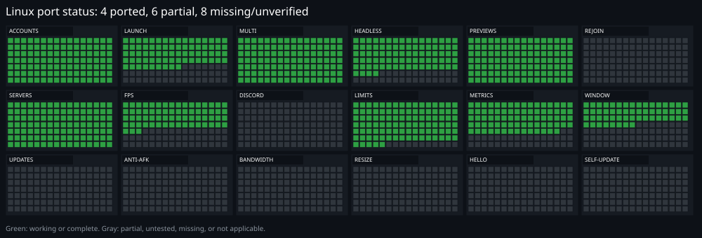

# Linux port progress

This describes the Linux fork of RoALT after the v0.9.0 merge. It is not a
statement about the upstream Windows application.

## Status key

| Status | Meaning |
|---|---|
| Ported | Works on Linux and has been exercised |
| Partial | Works with caveats, missing pieces, or limited verification |
| Missing | Not implemented on Linux |
| Untested | Present in the UI or code, but not verified |

The SVG uses green for ported areas and gray for partial, untested, missing, or
not-applicable areas.

Current totals: **12 ported, 10 partial**.

## Summary

| Category | Status | Coverage | Summary |
|---|---|---:|---|
| Accounts | Ported | 100% | Sign-in, vault, imports, groups, presence, account checks |
| Launching | Partial | 65% | Direct Cordial launch works; the game does not always open directly |
| Multi-client | Ported | 100% | One Cordial profile per account |
| Headless | Partial | 75% | Cage mode, previews and audio disable work; Show restarts, resolution is limited |
| Previews | Ported | 100% | Cordial devctl screenshots, including headless clients |
| Rejoin | Ported | 100% | Auto-rejoin/restart verified by closing a client |
| Servers | Ported | 100% | Server browser, private servers, same-server batches |
| FPS cap | Partial | 60% | Passed through `CORDIAL_FLAGS`; some builds/settings still ignore it |
| Discord | Ported | 100% | Webhook alerts and rich presence tested |
| Limits | Partial | 95% | Applied to the whole Cordial process family; trim is a no-op |
| Metrics | Partial | 70% | CPU, memory and disk I/O; no GPU counters |
| Window controls | Partial | 80% | Hyprland/Sway/X11 focus, micro and tile; free drag resize missing |
| Roblox updates | Ported | 100% | Handled automatically by Cordial |
| Anti-AFK | Partial | 80% | Hyprland/Sway/X11 F13 where tools exist; no idle detection |
| Free resizing | Ported | 100% | Handled by the compositor; RoALT adds micro/tile |
| Re-authentication | Ported | 100% | Master password; Windows Hello is not available |
| Self-update | Ported | 100% | Checks the Linux fork release, verifies SHA-256 and restarts |
| Interface | Ported | 100% | Account tabs, layouts, drag sorting, themes |
| Languages | Partial | 90% | 18 catalogs; some newer and Linux-only strings fall back to English |
| Max alts | Partial | 80% | FPS, fair cap, render flags and compositor tiny windows; trim still does not |
| Usage stats | Ported | 100% | Process-tree PSS and CPU/I/O reporting |
| Logs | Partial | 95% | Diagnostics and Linux log-tail autopsy work; no crash dumps/event log |

## Accounts

Ported.

- Roblox sign-in through WebKitGTK.
- Cookie import, cookie checks, cookie rotation and encrypted storage.
- Master-password vault, recovery code, `.roalt` backups.
- Groups, aliases, notes, colours, favourites and ordering.
- Avatars, presence, Robux, friends, followers, subscriptions and 2-step status.
- Import from Roblox Account Manager.
- Per-account FPS cap, Full quality and launch arguments.

## Launching

Partial.

Works:

- Direct `cordial-run` launches with per-account profiles.
- Game links, place IDs, job IDs, private servers, share links, profiles and
  `@username`.
- Batches, launch delay, same-server selection and favourites.
- Launch arguments and per-launch FPS caps.

Caveats:

- Launching does not always open the game directly.
- The Flatpak/Cordial-shell fallback follows a different path and does not get
  all of RoALT's direct-launch behavior.
- Sober fallback still exists in the launcher code but is not the supported path.

## Multi-client

Ported.

- One Cordial profile per account.
- Several clients at once through separate Cordial processes.
- Profile isolation for storage and login.

## Headless clients

Partial.

Works:

- `--headless` under cage with `WLR_BACKENDS=headless`.
- No host window and no audio stream.
- Devctl screenshots for previews.
- Process-tree tracking and memory reporting.

Caveats:

- A true headless client has no host window. Show closes it and starts it
  windowed.
- Headless resolution changes the window/display size, but the Roblox Vulkan
  swapchain can still stay at 1280x720. Real render-resolution reduction needs a
  Cordial change or a working engine flag.
- Headless handling can still be improved.

## Previews

Ported.

- Previews come from Cordial's dev-control socket, not from a host window.
- They work for headless clients.
- The 0.9 preview header (status, hidden flag, sequence and age) is implemented.

## Rejoin and restart

Ported.

- Auto-rejoin and auto-restart work.
- Closing a client reopened it as configured.
- Crash breaker, rejoin history and per-account disconnect policy are present.

## Servers

Ported.

- Public server browser, private servers, recent servers and same-server batches.
- Server selection uses the account's cookie.

## FPS cap

Partial.

- The effective cap is written into a merged `CORDIAL_FLAGS` file.
- `CORDIAL_FLAGS` outranks the profile's own flags for the launch.
- Some Cordial builds or game settings still ignore the cap, so treat it as best
  effort.

## Discord

Ported.

- Webhook alerts for crashes, disconnects, restarts and batches.
- Per-account muting.
- Rich presence through the local Discord app.

## Limits

Partial.

Works:

- CPU priority through niceness.
- Core affinity.
- Efficiency priority.
- Fair CPU cap and adaptive background limits.
- Memory throttle by reducing CPU priority.

Caveats:

- Working-set trim is a no-op on Linux.
- There is no Windows job-object equivalent for a hard CPU cap.
- Limits apply to the tracked process; the engine child is not independently
  limited.

## Metrics

Partial.

Works:

- CPU, memory and disk I/O per client in Monitor and on Home.
- Memory and Commit columns use PSS on Linux to avoid double-counting shared
  pages.

Missing:

- GPU usage and GPU memory counters.

## Usage stats

Ported.

- Headless memory sums the tracked process and all descendants, so a client is
  reported as the Cordial engine plus its cage wrapper rather than the cage alone.
- CPU and I/O are summed over the same process family.
- The values are PSS-based, which is the honest number for Linux memory pressure.

## Window controls

Partial.

Works on:

- Hyprland, through the Hyprland Lua dispatch API.
- Sway/i3-compatible Wayland, through `swaymsg`.
- X11, through `xdotool` or `wmctrl`.

On those, RoALT supports focus, hide/reveal, micro windows and grid tiling. Window lookup follows
child processes and cage.

Caveats:

- KDE/GNOME Wayland sessions without a supported control tool do not get these controls.
- Free drag-resizing is still not implemented.
- Headless clients have no host window to resize.

## Roblox updates

Ported.

- Cordial updates its own Roblox build automatically.
- RoALT does not run Roblox's Windows installer on Linux.

## Anti-AFK

Partial.

- On Hyprland, RoALT sends F13 directly to the client window with `hl.dsp.send_shortcut`.
- On Sway it uses `wtype` or `ydotool`; on X11 it uses `xdotool`.
- F13 is unbound in games, so it counts as activity without moving the character.
- There is no portable last-input timestamp, so the interval is the only gate.
- Compositors without a supported input tool have no equivalent path yet.

## Free resizing

Ported.

- Wayland and X11 compositors own drag-resize geometry, so the Windows mouse-hook path is not needed.
- RoALT adds micro-window sizing and grid tiling where the compositor tools support it.

## Re-authentication

Ported.

- Master password protects the vault and gates sensitive actions.
- Recovery codes work.
- Windows Hello itself is not available on Linux; the master password is the
  supported alternative.

## Self-update

Ported.

- Checks the Linux fork's latest release at startup and every five minutes.
- Compares four-part Linux tags such as `v0.9.0.1` and `v0.9.0.2`.
- Downloads the `roalt-linux-x86_64` asset and its SHA-256 sidecar.
- Replaces the running executable and restarts RoALT.
- The installer script remains the way to install Cordial, Cage and the desktop entry.

## Interface

Ported.

- Account tabs and per-account options.
- Top and side tab layouts.
- Drag-to-sort accounts and sections.
- Account rail.
- Detailed card layout.
- Themes, accent colours and background images.
- Performance profiles and the Performance tab.
- Headless resolution controls (display/window size only).

## Languages

Partial.

- 18 language catalogs are present.
- Language switching and right-to-left layout work.
- Some newer strings, including Linux-only headless strings, fall back to
  English until translated.

## Max alts

Partial.

Works:

- Low FPS.
- Fair CPU share.
- Lowest graphics and lighter-rendering flags.
- Hyprland/Sway/X11 tiny windows where supported.

Caveats:

- Memory trim is a no-op.
- Free drag-resizing is missing.

## Logs and diagnostics

Partial.

Works:

- RoALT's own rotating logs.
- Client stdout/stderr logs under `logs/clients/`.
- Diagnostics report with redaction.
- Linux autopsy: crash kind, uptime, reason, clues, and the redacted end of the
  client log.

Caveats:

- No crash dumps or Windows event-log details on Linux.
