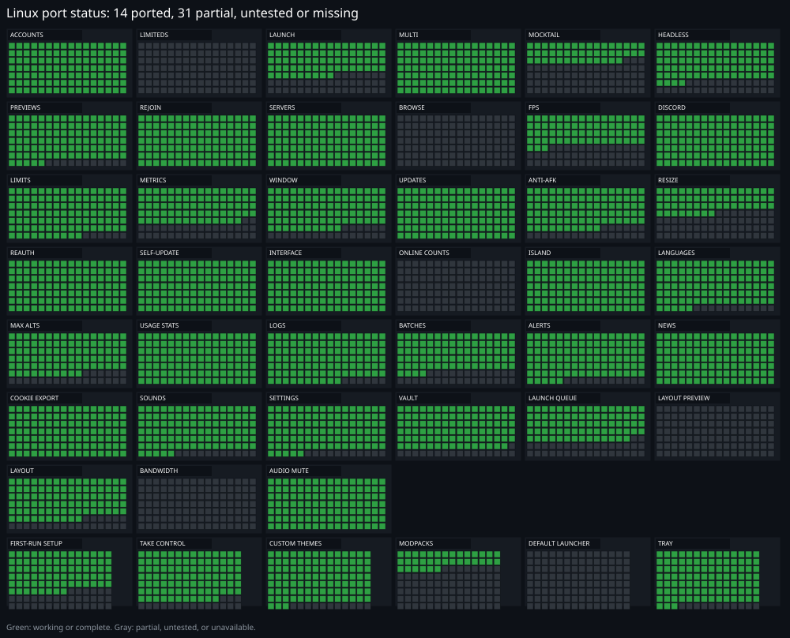

# Linux port progress

This describes the Linux fork of RoALT after the v1.1.0 merge. It is not a
statement about the upstream Windows application. Upstream removed macros in
v1.0.1, so macros are no longer a Linux port gap. The Mocktail backend is a
Linux-fork switch, not an upstream feature; it is listed as experimental.

## Status key

| Status | Meaning |
|---|---|
| Ported | Works on Linux and has been exercised |
| Partial | Works with caveats, missing pieces, or limited verification |
| Missing | Not implemented on Linux, or Windows-only |
| Untested | Present in the UI or code after the merge, but not verified on Linux |

The SVG uses green for ported areas and gray for partial, untested, missing, or
not-applicable areas.

Current totals: **15 ported, 24 partial, untested or missing** across 39 areas.

## Summary

| Category | Status | Coverage | Summary |
|---|---|---:|---|
| Accounts | Ported | 100% | Sign-in, vault, imports, groups, presence, account checks |
| Limiteds | Untested | 0% | Shared inventory and Rolimons code; not run on Linux |
| Launching | Partial | 65% | Direct Cordial launch works; the game does not always open directly |
| Launch queue | Partial | 70% | One-at-a-time queue is shared by Play, Home, Servers and recent servers; needs a Linux run |
| Batches and same server | Partial | 75% | Shared batch engine and same-server picking; needs a Linux run |
| Multi-client | Ported | 100% | One Cordial profile per account |
| Mocktail backend | Partial | 40% | Experimental launcher; multi-instance uses per-account copies, no previews, cookie seeded from the vault |
| Headless | Partial | 75% | Cage mode, previews and audio disable work; Show restarts, resolution is limited |
| Previews | Ported | 100% | Cordial devctl screenshots, including headless clients |
| Rejoin | Ported | 100% | Auto-rejoin/restart verified by closing a client |
| Servers | Ported | 100% | Server browser, private servers, same-server batches |
| Browse and details | Untested | 0% | v1.1.0 child webview, game and player details; not exercised under WebKitGTK |
| FPS cap | Partial | 60% | Passed through `CORDIAL_FLAGS`; some builds/settings still ignore it |
| Discord | Ported | 100% | Webhook alerts and rich presence tested |
| Alerts | Partial | 90% | Newer batch and client alert kinds use the existing Discord path; not yet run on Linux |
| Limits | Partial | 95% | Applied to the whole Cordial process family; trim is a no-op |
| Metrics | Partial | 70% | CPU, memory and disk I/O; no GPU counters |
| Window controls | Partial | 80% | Hyprland/Sway/X11 focus, micro and tile; free drag resize is compositor-managed |
| Roblox updates | Ported | 100% | Handled automatically by Cordial |
| Anti-AFK | Partial | 80% | Hyprland/Sway/X11 F13 where tools exist; no idle detection |
| Free resizing | Partial | 50% | Compositor-managed; the Windows mouse-hook path is a no-op |
| Window layouts | Partial | 80% | Fit/Tiny and micro/tile through the compositor where tools exist |
| Layout preview | Missing | 0% | Merged command uses Windows monitor and window APIs |
| Re-authentication | Ported | 100% | Master password; Windows Hello is not available |
| Self-update | Ported | 100% | Checks the Linux fork release, verifies SHA-256 and restarts |
| Interface | Ported | 100% | Account tabs, layouts, drag sorting, themes |
| Online counts | Untested | 0% | v1.1.0 title-bar counts and refresh; shared code, not run on Linux |
| Island redesign | Ported | 100% | Seen working under WebKitGTK in the v1.0.0 dev run |
| Languages | Partial | 90% | 18 catalogs; some newer and Linux-only strings fall back to English |
| Max alts | Partial | 80% | FPS, fair cap, render flags and compositor tiny windows; trim still does not |
| Usage stats | Ported | 100% | Process-tree PSS and CPU/I/O reporting |
| Logs | Partial | 95% | Diagnostics and Linux log-tail autopsy work; no crash dumps/event log |
| News | Ported | 100% | Loaded real RoALT, DevForum and Roblox news in the v1.0.0 dev run |
| Cookie export | Ported | 100% | `localtime_r` and atomic file writes on Linux |
| UI sounds | Untested | 90% | Shared frontend, off by default; not run under WebKitGTK |
| Settings search | Untested | 90% | Shared registry and search frontend; not run after the merge |
| Vault flow and recovery | Partial | 85% | Shared flow on the Linux device key; needs a run |
| Bandwidth / QoS | Missing | 0% | Linux backend is a no-op; the UI hides the row and search skips it |
| Audio mute | Ported | 100% | Uses `pactl` sink-inputs on PulseAudio/PipeWire |

## Accounts

Ported.

- Roblox sign-in through WebKitGTK.
- Cookie import, cookie checks, cookie rotation and encrypted storage.
- Master-password vault, recovery code, `.roalt` backups.
- Groups, aliases, notes, colours, favourites and ordering.
- Avatars, presence, Robux, friends, followers, subscriptions and 2-step status.
- Import from Roblox Account Manager.
- Per-account FPS cap, Full quality and launch arguments.

## Limiteds

Untested.

- v1.1.0 adds limiteds: count one account's limiteds for its total RAP and its
  most valuable items, or every account's at once from Home.
- Counting reads `inventory.roblox.com` with the account's own cookie, one page
  a second, up to 5,000 items, and keeps the result in the encrypted database.
- Opt-in **Rolimons values** add value, demand and trend from Rolimons' public
  item list (`api.rolimons.com`, at most every 30 minutes, off by default).
- The code is shared and has no Windows dependency, but it has not been run on
  Linux. Shown at 0% until it is.

## Browse, game and player details

Untested.

- v1.1.0 adds **Browse**: roblox.com inside the RoALT window, signed in as one
  stored account at a time, with **Popular**, **Playtime**, game pages and
  profile pages.
- Browse is a Tauri child webview (`browse.rs`, `Window::add_child`); RoALT
  builds against Tauri's `unstable` feature for it. On Linux that would be a
  WebKitGTK child of the main window, which is the untested part.
- **Game details** and **Player details** are pages inside Browse: players,
  visits, favourites, likes, server count, age rating, places, passes, badges,
  and a player's groups, badges, games and limiteds.
- RoALT keeps Browse on Roblox and refuses Robux-spending requests while
  **Lock purchases** is on.
- Not verified under WebKitGTK on Linux. If creating the child webview fails,
  `browse_open` rejects and the Browse pane shows the error. **Open on
  roblox.com** is itself Browse, so the external fallback is **Open profile** in
  the account menu.

## Launching

Partial.

Works:

- Direct `cordial-run` launches with per-account profiles.
- Game links, place IDs, job IDs, private servers, share links, profiles and
  `@username`.
- Batches, launch delay, same-server selection and favourites.
- Launch arguments and per-launch FPS caps.

Caveats:

- Launching does not always open the game directly.
- When Mocktail is installed, RoALT launches through it instead of Cordial; see
  the Mocktail section below.
- The Flatpak/Cordial-shell fallback follows a different path and does not get
  all of RoALT's direct-launch behavior.
- Sober fallback still exists in the launcher code but is not the supported path.

## Launch queue

Partial.

- Play, Home's tabs and cards, Servers, Recently closed and an account's recent
  servers share one launch engine.
- Launches run one at a time; a running batch blocks a single launch too.
- The per-launch FPS cap and the launch-progress view travel with the queue.
- The shared frontend and batch backend are present after the merge, but the
  integrated paths have not been exercised on Linux.

## Batches and same server

Partial.

- Accounts launch one after another with a stagger.
- **Same server** either picks a public server with room for everyone or sends
  the rest to wherever the first account landed.
- Cancel and re-pick the accounts that did not launch.
- The v1.0.0 batch code is shared with upstream and still needs a Linux run.

## Multi-client

Ported.

- One Cordial profile per account.
- Several clients at once through separate Cordial processes.
- Profile isolation for storage and login.

## Mocktail backend (experimental)

Partial.

- RoALT prefers `mocktail` on `PATH`, then `~/.local/bin/mocktail`, then `/usr/bin/mocktail`, and otherwise
  uses the Cordial path above. `ROALT_LAUNCHER=/usr/bin/cordial-run` forces
  Cordial when both are installed.
- Single-instance only: one Roblox client at a time. Mocktail has no
  per-account profile to separate a second client, so Cordial remains the
  multi-instance option.
- No live preview and no dev-control: Mocktail exposes no devctl socket, so
  Home has no preview frames and the headless screenshot path has nothing to
  read.
- Per-account cookie: before a launch RoALT writes the chosen account's cookie
  from the encrypted vault into the directory named by `MOCKTAIL_AUTH_ROOT`, so
  the client signs in as that account. That copy sits outside the vault and is
  not encrypted there; keep the directory private.
- The switch and the cookie handoff are present, but no signed-in Mocktail
  launch has been verified on Linux. Shown at 40% until one is, and this is not
  a drop-in replacement for Cordial.

## Headless clients

Partial.

Works:

- `--headless` under cage with `WLR_BACKENDS=headless`.
- No host window and no audio stream.
- Devctl screenshots for previews.
- Process-tree tracking and memory reporting.

Caveats:

- A true headless client has no host window. Show closes it and starts it
  windowed.
- Headless resolution changes the window/display size, but the Roblox Vulkan
  swapchain can still stay at 1280x720. Real render-resolution reduction needs a
  Cordial change or a working engine flag.
- Headless handling can still be improved.

## Previews

Ported.

- Previews come from Cordial's dev-control socket, not from a host window.
- They work for headless clients.
- The 0.9 preview header (status, hidden flag, sequence and age) is implemented.

## Rejoin and restart

Ported.

- Auto-rejoin and auto-restart work.
- Closing a client reopened it as configured.
- Crash breaker, rejoin history and per-account disconnect policy are present.

## Servers

Ported.

- Public server browser, private servers, recent servers and same-server batches.
- Server selection uses the account's cookie.

## FPS cap

Partial.

- The effective cap is written into a merged `CORDIAL_FLAGS` file.
- `CORDIAL_FLAGS` outranks the profile's own flags for the launch.
- Some Cordial builds or game settings still ignore the cap, so treat it as best
  effort.

## Discord

Ported.

- Webhook alerts for crashes, disconnects, restarts and batches.
- Per-account muting.
- Rich presence through the local Discord app.

## Alerts

Partial.

- The v1.0.0 merge adds richer batch and client alerts on the existing Discord
  webhook path.
- The transport is the same cross-platform backend that already works on Linux.
- The new alert kinds have not been triggered in a Linux run after the merge.

## Limits

Partial.

Works:

- CPU priority through niceness.
- Core affinity.
- Efficiency priority.
- Fair CPU cap and adaptive background limits.
- Memory throttle by reducing CPU priority.

Caveats:

- Working-set trim is a no-op on Linux.
- There is no Windows job-object equivalent for a hard CPU cap.
- Limits apply to the tracked process; the engine child is not independently
  limited.

## Metrics

Partial.

Works:

- CPU, memory and disk I/O per client in Monitor and on Home.
- Memory and Commit columns use PSS on Linux to avoid double-counting shared
  pages.

Missing:

- GPU usage and GPU memory counters.

## Usage stats

Ported.

- Headless memory sums the tracked process and all descendants, so a client is
  reported as the Cordial engine plus its cage wrapper rather than the cage alone.
- CPU and I/O are summed over the same process family.
- The values are PSS-based, which is the honest number for Linux memory pressure.

## Window controls

Partial.

Works on:

- Hyprland, through the Hyprland Lua dispatch API.
- Sway/i3-compatible Wayland, through `swaymsg`.
- X11, through `xdotool` or `wmctrl`.

On those, RoALT supports focus, hide/reveal, micro windows and grid tiling. Window lookup follows
child processes and cage.

Caveats:

- KDE/GNOME Wayland sessions without a supported control tool do not get these controls.
- Headless clients have no host window to resize.

## Free resizing and window layouts

Partial.

- Wayland and X11 compositors own drag-resize geometry, so the Windows
  low-level mouse-hook path is a no-op (`resize_linux.rs`).
- RoALT adds micro-window sizing and Fit/Tiny grid tiling where the compositor
  tools support it.
- The upstream "drag past Roblox's minimum without snapping back" behavior is
  compositor-managed, not reproduced by RoALT on Linux.

## Layout preview

Missing.

- Upstream v1.0.0 draws the planned window spots for a few seconds before a
  launch.
- The merged command reads the main window's Windows handle and uses the
  Windows monitor/window helpers, so it is not available on Linux yet.
- A Linux implementation would need the compositor work-area and slot geometry
  from `window_linux.rs`.

## Roblox updates

Ported.

- Cordial updates its own Roblox build automatically.
- RoALT does not run Roblox's Windows installer on Linux.

## Anti-AFK

Partial.

- On Hyprland, RoALT sends F13 directly to the client window with `hl.dsp.send_shortcut`.
- On Sway it uses `wtype` or `ydotool`; on X11 it uses `xdotool`.
- F13 is unbound in games, so it counts as activity without moving the character.
- There is no portable last-input timestamp, so the interval is the only gate.
- Compositors without a supported input tool have no equivalent path yet.

## Re-authentication

Ported.

- Master password protects the vault and gates sensitive actions.
- Recovery codes work.
- Windows Hello itself is not available on Linux; the master password is the
  supported alternative.

## Vault flow and recovery

Partial.

- The v1.0.0 merge brings the clearer unlock and recovery flow and the recovery
  code guidance.
- On Linux the vault key is derived from the machine id and user id, so the
  master password remains the protection against a copied database.
- The shared flow is present but has not been exercised on Linux after the
  merge.

## Self-update

Ported.

- Checks the Linux fork's latest release at startup and every five minutes.
- Compares four-part Linux tags such as `v0.9.2.2` and the expected `v1.1.0.1`.
- Downloads the `roalt-linux-x86_64` asset and its SHA-256 sidecar.
- Replaces the running executable and restarts RoALT.
- The installer script remains the way to install Cordial, Cage and the desktop entry.

## Interface

Ported.

- Account tabs and per-account options.
- Top and side tab layouts.
- Drag-to-sort accounts and sections.
- Account rail.
- Detailed card layout.
- Themes, accent colours and background images.
- Performance profiles and the Performance tab.
- Headless resolution controls (display/window size only).

## Online counts and title-bar refresh

Untested.

- v1.0.1 added the online counter; v1.0.2 added the accounts-playing count. Both
  sit beside the Discord button in the title bar.
- Every 2 minutes RoALT POSTs a random ID made once per launch and how many
  Roblox clients it runs to a Cloudflare Worker (`server/online-counter`). The
  worker answers with RoALTs seen in the last 5 minutes and their clients added
  up (each ping counts for at most 100 accounts).
- Off with **Settings › About → Show how many people use RoALT**: nothing is
  sent and no count is shown. On by default.
- The ping is shared `reqwest` code (`online.rs`) with no Windows dependency, and
  the title bar is shared React UI, but neither has been exercised on Linux.
- v1.0.1 also added the title-bar **Refresh** (`F5`) key beside the layout key;
  shared frontend, not yet run under WebKitGTK.
- v1.1.0 made the UI faster: languages and views load lazily and resting in the
  tray hides the page so its polls and previews stop. The extra WebView2 memory
  target has no Linux equivalent, so only the page hiding applies here.

## Island redesign

Ported.

- The v1.0.0 island replaces the old title-bar navigation with a pill that holds
  every section and grows launch progress and running clients out of its side.
- It was seen working under WebKitGTK in the v1.0.0 dev run.
- Re-check it after the v1.1.0 merge along with the rest of the shell.

## Settings search and registry

Untested.

- Settings render from a registry; one search covers Settings, Performance and
  Discord and jumps to the matching row.
- Rows whose backend is Windows-only are left out on Linux: the bandwidth/QoS
  row is hidden and search skips it.
- The registry and search are shared frontend code.
- Not verified under WebKitGTK after the merge.

## UI sounds

Untested.

- Short click, toggle, notification, success and error sounds are synthesised
  locally in the frontend.
- Sounds are **off by default** and have a volume control and preview.
- The shared frontend is present; WebKitGTK audio output has not been checked.

## News

Ported.

- Home's News tab fetches RoALT releases from GitHub, Roblox DevForum
  announcements and release notes, and the Roblox newsroom.
- The backend is shared `reqwest` code with no Windows dependency.
- Verified under WebKitGTK in the v1.0.0 dev run.

## Cookie export

Ported.

- Upstream writes selected accounts as `username:cookie` lines to a temporary
  file, then deletes it after ten minutes or at the next start.
- Linux uses `localtime_r` and the same atomic file write and cleanup path as
  Windows. The file remains in the RoALT data folder until its timer or restart.

## Macros (removed upstream)

Not an area. Upstream removed macros in v1.0.1:

- The macros page, the client-menu actions, the macros settings and the backup
  entries are gone; migration `012_drop_macros.sql` drops the table, and the
  panic hotkey has the global-shortcut handler to itself.
- `src-tauri/src/macros.rs` no longer exists upstream, and this fork does not
  carry a macro runner.
- There is nothing to port and no Linux gap. The v1.0.0 Linux notes that called
  macros "Windows-only" are obsolete.

## Bandwidth / QoS

Missing.

- Upstream applies one upload cap through a Windows QoS policy.
- The Linux backend is an explicit no-op that keeps the setting and boot
  tracking so the UI can show the option as unavailable.
- No Linux traffic policy is applied.

## Audio mute

Ported.

- Upstream mutes a client's Windows Core Audio session on launch.
- Linux finds the client's `pactl` sink-inputs by `application.process.id` and mutes or unmutes
  them. It retries for a few seconds because a client opens audio after reaching a game.
- PulseAudio and PipeWire both provide `pactl`. A silent or missing audio session is logged and
  left alone.
- The setting is accepted but has no effect.

## Languages

Partial.

- 18 language catalogs are present.
- Language switching and right-to-left layout work.
- Some newer strings, including Linux-only headless strings and v1.0.0/v1.1.0
  additions, fall back to English until translated.

## Max alts

Partial.

Works:

- Low FPS.
- Fair CPU share.
- Lowest graphics and lighter-rendering flags.
- Hyprland/Sway/X11 tiny windows where supported.

Caveats:

- Memory trim is a no-op.
- Free drag-resizing is compositor-managed.

## Logs and diagnostics

Partial.

Works:

- RoALT's own rotating logs.
- Client stdout/stderr logs under `logs/clients/`.
- Diagnostics report with redaction.
- Linux autopsy: crash kind, uptime, reason, clues, and the redacted end of the
  client log.

Caveats:

- No crash dumps or Windows event-log details on Linux.
